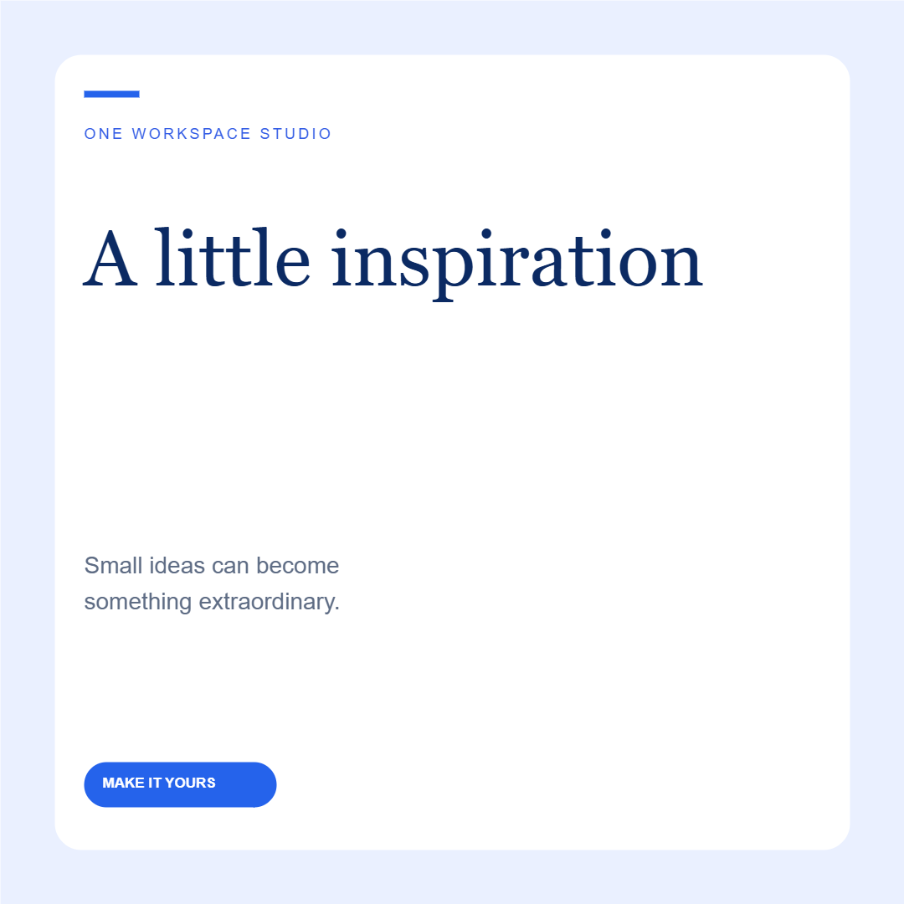
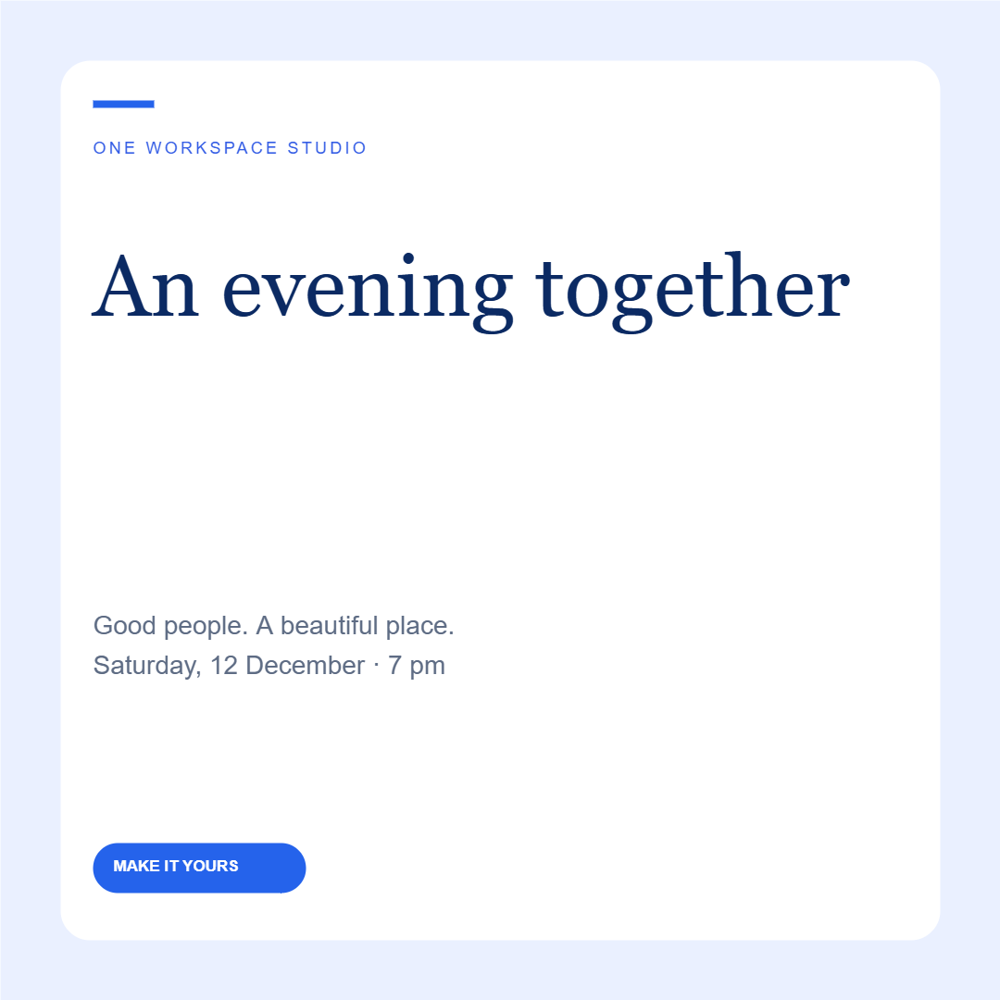
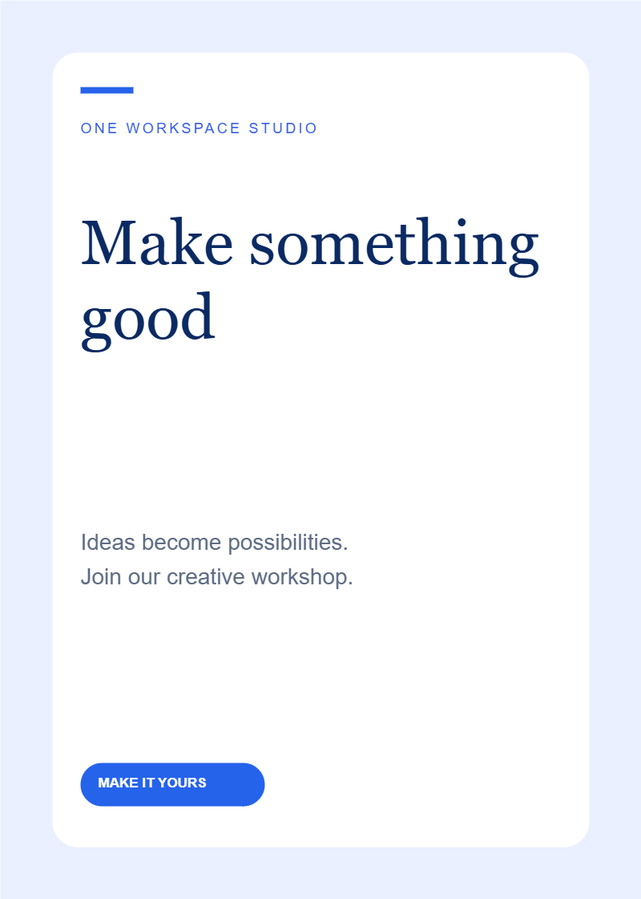

# My Create Templates

Original, editable starter designs for [My Create](https://github.com/oneworkspacestudio/my-create).
Download a `.mycreate` pack and choose **Import a design** in the app. Packs work
offline and carry their preview, editable layers, licence and SHA-256 manifest.
The same three starters are built into My Create.

| Social post | Invitation | Flyer |
|---|---|---|
|  |  |  |
| [Download](packs/social-1.0.0.mycreate) | [Download](packs/invitation-1.0.0.mycreate) | [Download](packs/flyer-1.0.0.mycreate) |

All artwork here is authored from simple shapes and text for One Workspace Studio
and dedicated under **CC0-1.0**. Font files are not included; local fonts may
substitute. No Canva templates or third-party catalogue assets are redistributed.

`catalog.json` records each pack version, categories, keywords, licence, author,
size and SHA-256. Existing versioned packs are immutable; publish updates under
new filenames/versions. My Create validates all internal hashes before opening.
Source generator: `scripts/export-starters.mjs` in the My Create repository.

To contribute, export a template with clear attribution and the rights to every
included asset, then submit it for review. Publishing private designs requires
the owner's explicit approval; the app never uploads designs here automatically.
